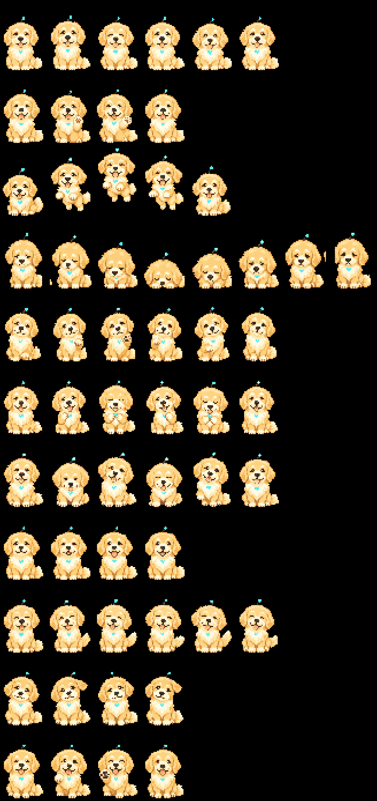

# Mecha Golden — StackChan digital pet that talks (GPT-Live)

M5Stack **StackChan** (CoreS3) の画面に住む、ゴールデンレトリバーの子犬ロボット「メカゴールデン」です。
OpenAI の **GPT-Live** (`gpt-live-1`) で声で会話し、**Decisions API** (`gpt-6-luna`) で「話しかけられたか」「どの鳴き声で鳴くか」を判断します。



> デモ動画: (近日追加)

## できること
- **声で会話** (GPT-Live): 頭のセンサーを 1 秒長押しで会話を始める。日本語の声 (harema)。英語で話しかけると英語で返す。天気やニュースは裏で web 検索
- **しゃべりながら聞く**: 本体でマイクとスピーカーを同時に動かし、自分の声を ESP-SR のエコー除去で消す。返事の直後に話し始めても言葉の頭が切れない (声でさえぎる機能は試験中)
- **話しかけ判定** (Decisions API): 人どうしの会話や独り言には返事をしない
- **会話の終わり方**: 「バイバイ」と言う / 頭をもう一度長押し / 画面右上の「end x」/ 5 分話しかけなければ自然に終わる
- **触ると鳴く**: 頭のタップ・連打・なでる・逆なで・画面の顔で、子犬の声 (8 種類 × 3 通り) で鳴く。どの声かは Decisions API が触り方と状況で選ぶ
- **ドット絵**: 画像生成 (gpt-image-2) で作った 11 種類のポーズ (chilling / listening... / talking / thinking... / happy! / paw! など)
- **本体だけ (Wi-Fi) でも動く**: Mac につながなくても会話できる (音質は電話くらい。下の「本体だけで動かす」)

## 必要なもの
| もの | メモ |
|---|---|
| M5Stack StackChan (CoreS3 版) | 本体 |
| Mac (Apple シリコン、macOS) | 書き込みと、会話の中継に使う。Linux でも動く見込み (未確認) |
| USB-C ケーブル | 本体の付属品で可 |
| OpenAI の API キー | GPT-Live と Decisions API が使えるもの |
| (任意) ElevenLabs の API キー | 鳴き声を作り直す時だけ |

## 費用の目安
- GPT-Live: 会話している間だけ **1 分あたり $0.05** (1 時間 約 $3)。待機中はかからない
- 調べもの (gpt-6-luna + web 検索): 調べた時だけ
- Decisions API: 1 回 約 $0.00006。会話中の話しかけ判定と鳴き声選びで使う (1 時間使っても数セント)

## 音の扱い
- 会話している間、本体のマイクの音は **OpenAI に送られます**。待機中は送りません
- 会話は頭の長押しで始めます (勝手に聞き取りは始めません)
- `--trace` を付けると、調整用に会話の音と時刻を `bridge/eval/sessions/` に残します (Git には入りません)

## はじめかた
> Claude Code にこのリポジトリを渡して「スタックチャンのセットアップをして」と頼めるセットアップ Skill を近日追加します (`.claude/skills/stackchan-pet-setup/`)

```sh
git clone <このリポジトリ>
cd <このリポジトリ>
./scripts/setup.sh          # 開発環境 (arduino-cli・ボードパッケージ・ライブラリ・Python) をリポジトリの中に用意
# .env に OPENAI_API_KEY を書く
```
1. **買った時のファームをバックアップする** (戻せるように。約 1 分):
   `.venv/bin/esptool read-flash 0 ALL backup/factory.bin` — 戻す時は `.venv/bin/esptool write-flash 0 backup/factory.bin`
   (書き込むと工場出荷の AI 機能は消えます。M5Burner からも戻せます)
2. **書き込む**: `./build.sh` (約 1 分)
3. **中継を動かす**: `./talk.sh start` → 頭を 1 秒長押しして話しかける。止める時は `./talk.sh stop`
4. 動作確認 (API を使わない): `.venv/bin/python -I bridge/live_bridge.py --selftest` (マイク録音とスピーカー再生)

性格は `bridge/persona.md` を書き換えると変わります (次の会話から反映)。

## 本体だけで動かす (Wi-Fi)
1. `.env` に `STACKCHAN_WIFI_SSID` / `STACKCHAN_WIFI_PASS` (2.4GHz のみ) と、本体に入れるキーを書く
2. `.venv/bin/python -I tools/provision.py` (USB で本体の不揮発メモリに書き込む。値は表示しない)
3. USB を抜くと 5 秒で本体だけのモードになる。画面右上の wifi が明るければ準備完了
- 注意: キーが本体に入るので、本体を人に渡す時はキーを止めるか書き換える。音声は帯域の都合で 8kHz (電話の音質)

## 構成
```
mecha_retriever/      本体のプログラム (最新版)
  pet.cpp             画面・状態・タッチ
  talk.cpp            会話の音声 (USB / 本体だけの両方)
  duplex.cpp          しゃべりながら聞く (I2S 全二重 + ESP-SR AEC + スピーカーホン式の絞り)
  brain.cpp           本体だけで動く時の頭脳 (Wi-Fi → GPT-Live / Decisions)
  camera.cpp          カメラ (※ 現在は duplex と併用すると映らない)
  sprites.h, sounds.h ドット絵と鳴き声 (tools/ で生成)
mecha_retriever_v1/   最初の版 (コードで描いた子犬、会話なし)
mecha_retriever_v2/   GPT-Live で話せるようになった最初の版
bridge/               Mac 側の中継 (live_bridge.py)、判定 (decide.py)、評価の道具
tools/                書き込み設定・画面の取り込み・鳴き声とドット絵の生成
petgen/               ドット絵の生成に使った指示文と生成画像 (hatch-pet の手順)
```

## 評価の道具
- `bridge/ab_test.py`: 2 つの設定を同じ時間帯に走らせ、「話し終わり → 返事の最初の音」を中央値・90%・信頼区間で比べる
- `bridge/analyze_session.py`: `--trace` の記録から、口から耳までの遅れ・返事なし・かぶり・文字の誤り率を出す
- 調べた結果: 声の種類・16/24kHz・指示文を変えても、GPT-Live が話し終わりを判断する時間 (約 1.3〜1.45 秒) は変わらなかった

## 既知の問題
- カメラ (人に気づく・手を振り返す・お手・首を上げる) は、しゃべりながら聞く方式と一緒だと映らない
- 声でさえぎる判定は、普通の声で効くか未確認 (タッチでのさえぎりは動く)
- Apple シリコンで Rosetta が無いと Arduino の ctags が動かない (setup.sh で回避)
- ライブラリマネージャーの StackChan-BSP 1.0.1 はビルドできない (setup.sh で GitHub の版を入れる)

## 使っているもの
- [M5Stack StackChan-BSP](https://github.com/m5stack/StackChan-BSP) (MIT), M5Unified / M5GFX (MIT)
- ESP-SR (Espressif) のエコー除去 — arduino-esp32 に同梱
- ドット絵: gpt-image-2 で生成 (hatch-pet の手順を参考)。鳴き声: ElevenLabs の効果音生成で作成
- 参考: [xiaozhi-esp32](https://github.com/78/xiaozhi-esp32) の CoreS3 音声の作り

## License
MIT (c) 2026 Kaishu Shito — [LICENSE](LICENSE)
